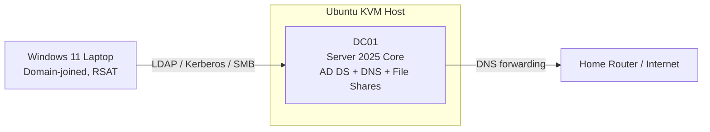

# ZaidCo Windows Domain Lab

A home lab build of a small company's Windows environment: a Server Core domain controller on a Linux KVM host, a domain-joined Windows 11 workstation, role-based access on the principle of least privilege, Group Policy, and PowerShell scripts for onboarding and offboarding.

**Skills:** Active Directory · Group Policy · PowerShell · AGDLP group design · NTFS/SMB permissions · DNS · Windows Server Core · RSAT remote administration · KVM/libvirt · Linux troubleshooting

---

## Highlights

- **Access designed before it was built.** Every role's access to every department folder was decided in an [access matrix](docs/build_log.md#access-matrix) first. No regular user has Full Control, IT can't read other departments' data, and executives are read-only on department folders.
- **AGDLP group model.** Users go only into Global groups, Global groups nest into Domain Local groups, and NTFS permissions are granted only to Domain Local groups. Access changes happen through group membership, never by editing folder permissions.
- **Group Policy aligned with NIST 800-63B rev 4.** 15-character minimum, no forced expiration, no complexity rules, account lockout, and advanced audit logging for the events a SOC would investigate.
- **A policy that looked configured but never applied.** My lockout policy lost to Default Domain Policy in link order, so lockout was silently off. I found it by checking the effective policy instead of the settings page, then restructured into single-purpose GPOs. [Details](docs/group-policy.md#troubleshooting)
- **Joiner/leaver automation.** PowerShell scripts create users from a CSV into the right OU and group, disable and strip departing users, log every offboarding, and export a current-employee report.

---

## Contents

| Document | What's in it |
|---|---|
| [Build Log](docs/build_log.md) | Environment, access matrix, step-by-step build, permission testing, troubleshooting log |
| [Group Policy](docs/group-policy.md) | Account, audit, drive mapping, and software deployment GPOs, with the reasoning behind each setting |
| [Scripts](scripts/) | Onboarding, offboarding, and current-employee report scripts |
| Tickets & KB articles | *Coming soon:* break-fix tickets worked in ServiceNow and end-user knowledge base articles |

---

## Environment

| Component | Details |
|---|---|
| Hypervisor | Ubuntu Server, KVM/libvirt, managed with Cockpit |
| Domain controller | `DC01`, Windows Server 2025 Standard Eval (Server Core) |
| Domain | `lab.local` |
| Workstation | Windows 11 Pro laptop, domain-joined, RSAT installed |
| Organization | Five departments (Sales, HR, Finance, IT, Management), each with a department head and staff |

---

## Lab vs. Production

Some choices were made for a home lab and would be done differently in a real environment:

- **File shares are on the domain controller.** In production they belong on a dedicated file server. They're on DC01 here because of RAM limits.
- **The lab shares the home network.** A production DC would sit on a segmented network, not alongside personal devices.
- **One domain controller.** Production needs at least two for redundancy.
- **Onboarding uses one temporary password per batch.** Production would generate a unique password per user and deliver it securely.
- **7-Zip 21.07 is deployed as the sample package.** In production, deployed software is kept current.
