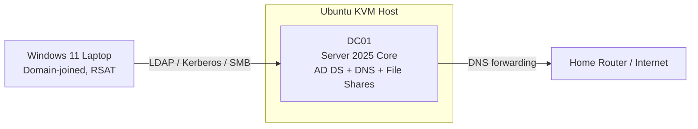
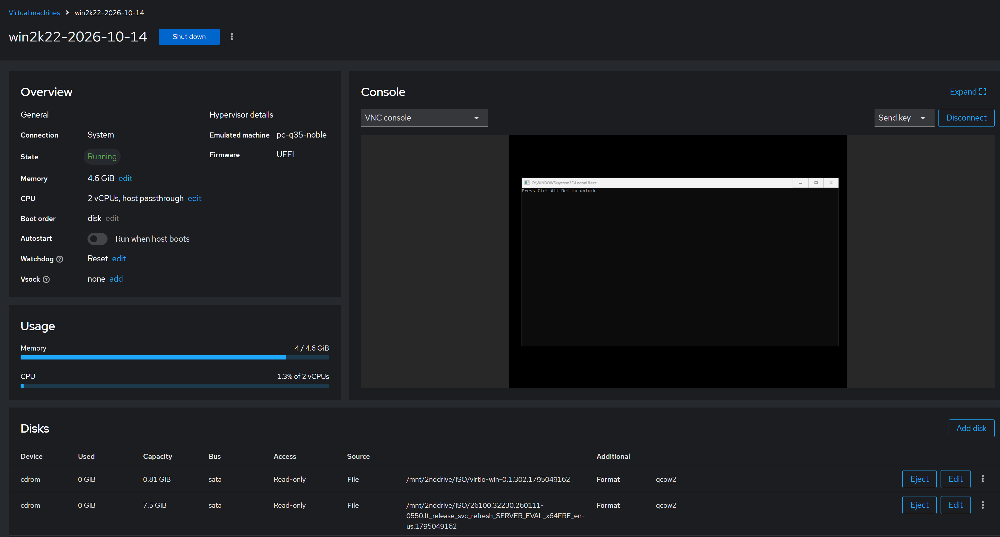
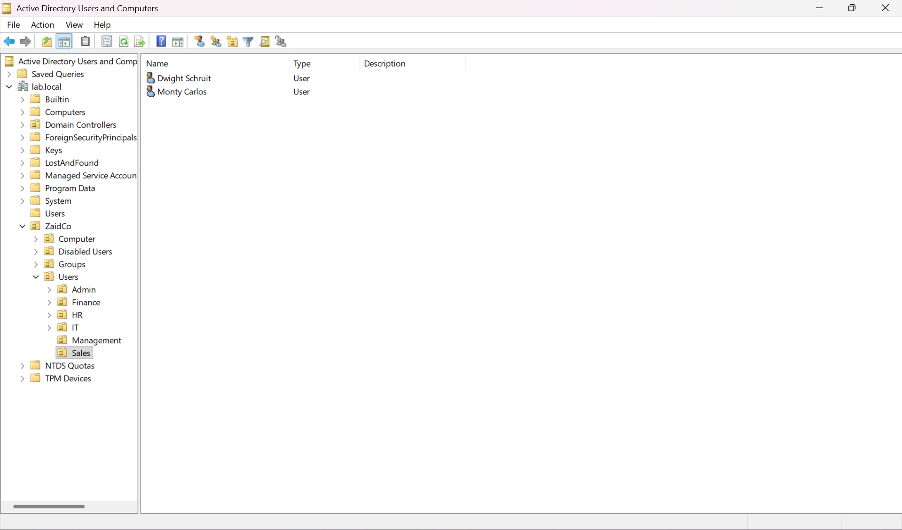
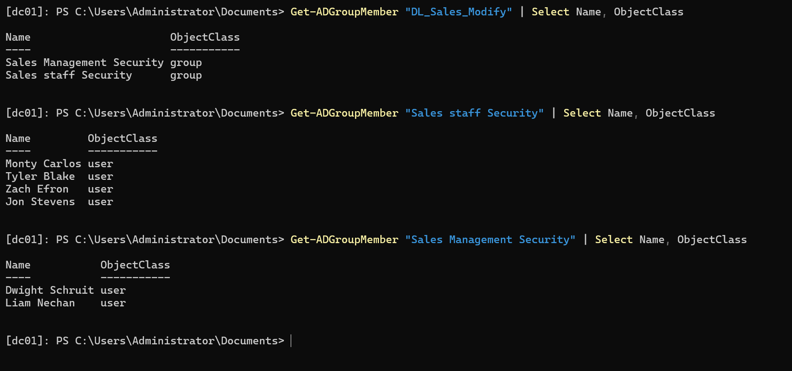
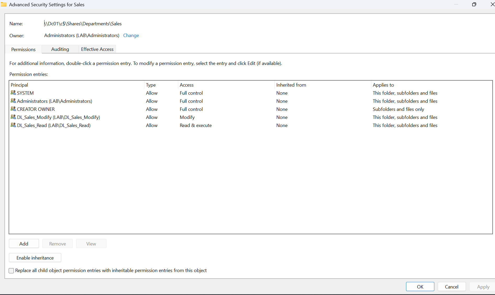

# Build Log: ZaidCo Windows Domain

A home lab build of a small company's Windows environment: a Server Core domain controller on a Linux KVM host, a domain-joined Windows 11 workstation, department OUs, role-based security groups using Microsoft's AGDLP model, and department file shares locked down with NTFS permissions on the principle of least privilege.

**Skills:** KVM/libvirt · Windows Server Core · Active Directory · DNS · AGDLP group design · NTFS/SMB permissions · RSAT remote administration · PowerShell · Linux troubleshooting

---

## Environment

| Component | Details |
|---|---|
| Hypervisor | Ubuntu Server, KVM/libvirt, managed with Cockpit |
| Domain controller | `DC01`, Windows Server 2025 Standard Eval (Server Core), 2 vCPU / 4 GiB RAM / 60 GB disk |
| Domain | `lab.local` |
| Workstation | Windows 11 Pro laptop, domain-joined, RSAT installed |



---

## Access Matrix

Every permission was decided before anything was built. For each cell: *does this role need this access to do their job?* If not, None.

| Role | Sales | HR | Finance | IT | Management | Company |
|---|---|---|---|---|---|---|
| Sales Staff | Modify | None | None | None | None | Read |
| Sales Manager | Modify | None | None | None | None | Modify |
| HR Staff | None | Modify | None | None | None | Read |
| HR Manager | None | Modify | None | None | None | Modify |
| Finance Staff | None | None | Modify | None | None | Read |
| Finance Manager | None | None | Modify | None | None | Modify |
| IT Staff | None | None | None | Modify | None | Read |
| IT Manager | None | None | None | Modify | None | Modify |
| Executive | Read | Read | Read | Read | Modify | Modify |
| Admin accounts | Full Control | Full Control | Full Control | Full Control | Full Control | Full Control |

- **No regular user gets Full Control.** It allows changing permissions, which would let users grant access and skip approval.
- **IT can't read other departments' data.** Managing a folder doesn't require reading it. Admin work is done with separate admin accounts.
- **Executives are read-only on department folders.** Seniority doesn't decide access, and executives are top phishing targets.

---

## Testing

| Test | Expected | Result |
|---|---|---|
| Sign in as Sales staff | Success | ✅ Pass |
| Open and modify files in `\\DC01\Sales` | Allowed | ✅ Pass |
| Open `\\DC01\IT` | Access denied | ✅ Pass |
| Open other department folders | Access denied | ✅ Pass |

[Access denied test](../Misc/Images/permtest.md)

---

## Troubleshooting Log

| Problem | Cause | Fix |
|---|---|---|
| Windows Setup couldn't see the virtual disk | No built-in VirtIO storage driver | Loaded `viostor` from the VirtIO ISO during setup |
| `dsa.msc` wouldn't open on the DC | Server Core can't run graphical consoles | Installed RSAT on the workstation and managed the DC remotely |
| RSAT finished but `dsa.msc` wasn't found | Install never completed (`State: NotPresent`) | Reinstalled via Settings → Optional features, verified with `Get-WindowsCapability` |
| Every domain user could read every new folder | New folders inherit a `Users` entry from `C:\` | Disabled inheritance and removed the `Users` entries |
| DC VM failed to start: "cannot load AppArmor profile" | Host filesystem corruption from an unclean shutdown | Repaired the filesystem (next row) |
| Host booted to an `(initramfs)` shell | `/dev/nvme0n1p2` needed a manual filesystem check | `fsck -y /dev/nvme0n1p2`, then `exit` to continue booting |
| libvirt wouldn't restart: `start-limit-hit` | Repeated restarts tripped systemd's limit and left the sockets down | `systemctl reset-failed`, then started the libvirt sockets |

**Prevention:** `libvirt-guests` shuts VMs down cleanly with the host, the DC autostarts after a host reboot, no hard power-offs, and VM backups are kept off the host.

---

## Build Steps

<details>
<summary><b>1. VM setup</b></summary>

- Installed Cockpit on the Ubuntu host to manage VMs from a web interface.
- Downloaded the Windows Server 2025 evaluation ISO and the VirtIO driver ISO.
- Created the VM: 2 vCPU, 4 GiB RAM, 60 GB disk.



</details>

<details>
<summary><b>2. Windows Server Core install</b></summary>

- Installed Server 2025 Standard **without the Desktop Experience**: smaller attack surface, fewer updates, less RAM.
- Loaded the `viostor` driver during setup so the installer could see the disk.
- Installed the remaining VirtIO drivers afterward, including networking.

</details>

<details>
<summary><b>3. Domain controller configuration</b></summary>

- Set a static IP outside the router's DHCP range to avoid conflicts.
- Renamed the server to `DC01` before promotion.
- Installed AD DS and created the forest:

```powershell
Install-WindowsFeature AD-Domain-Services -IncludeManagementTools
Install-ADDSForest -DomainName "lab.local"
```

- After the reboot, confirmed DNS moved to `127.0.0.1`. The DC is now its own DNS server, which AD depends on.

</details>

<details>
<summary><b>4. Remote management workstation</b></summary>

- Joined the Windows 11 laptop to `lab.local` and signed in as the domain admin.
- Installed RSAT to manage the DC remotely, the normal setup for Server Core:

```powershell
Add-WindowsCapability -Online -Name "Rsat.ActiveDirectory.DS-LDS.Tools~~~~0.0.1.0"
```

</details>

<details>
<summary><b>5. OU structure and users</b></summary>

Built custom OUs instead of the default containers, since Group Policy can only link to OUs.

```
ZaidCo
├── Users
│   ├── HR
│   ├── Finance
│   ├── Sales
│   ├── IT
│   ├── Management
│   └── Admin
├── Groups
├── Computers
└── Disabled Users
```

- Five departments, each with a department head and staff members.
- Each user got a temporary password with "change at next logon," plus Title, Department, and Manager filled in.



</details>

<details>
<summary><b>6. Group design (AGDLP)</b></summary>

**A**ccounts → **G**lobal groups → **D**omain **L**ocal groups → **P**ermissions

| Layer | Purpose | Examples |
|---|---|---|
| Global | Who people are | `Sales Security`, `Sales Manager Security`, `All Management Security` |
| Domain Local | Access to one folder at one level | `DL_Sales_Modify`, `DL_Sales_Read` |
| NTFS | Granted to DL groups only | `DL_Sales_Modify` → Modify on `\\DC01\Sales` |

- Users go **only** into Global groups.
- Folder permissions are set once. Access changes happen through group membership, which also makes access reviews easy.
- `Domain Users` grants company-wide read on the Company folder.



</details>

<details>
<summary><b>7. File shares and NTFS permissions</b></summary>

```powershell
New-Item -ItemType Directory -Path C:\Shares\Sales
New-SmbShare -Name Sales -Path C:\Shares\Sales -FullAccess "Authenticated Users"
```

Repeated for HR, Finance, IT, Management, and Company.

- Share permissions left open on purpose. The stricter layer wins, so all real control lives in NTFS.
- On each folder: disabled inheritance, removed `Users`, kept `SYSTEM`, `Administrators`, and `CREATOR OWNER`, and granted only the folder's DL groups.

> In production, file shares belong on a dedicated file server, not a DC. They're on DC01 here because of lab RAM limits.



</details>

---

## Lessons Learned

- **OUs and groups do different jobs.** OUs decide where an account lives and which policies apply. Groups decide what it can access.
- **Design access before building it.** The matrix made every later step mechanical.
- **Least privilege applies to everyone,** executives and IT included.
- **Lab infrastructure needs production habits.** One unclean shutdown took down the whole domain.
